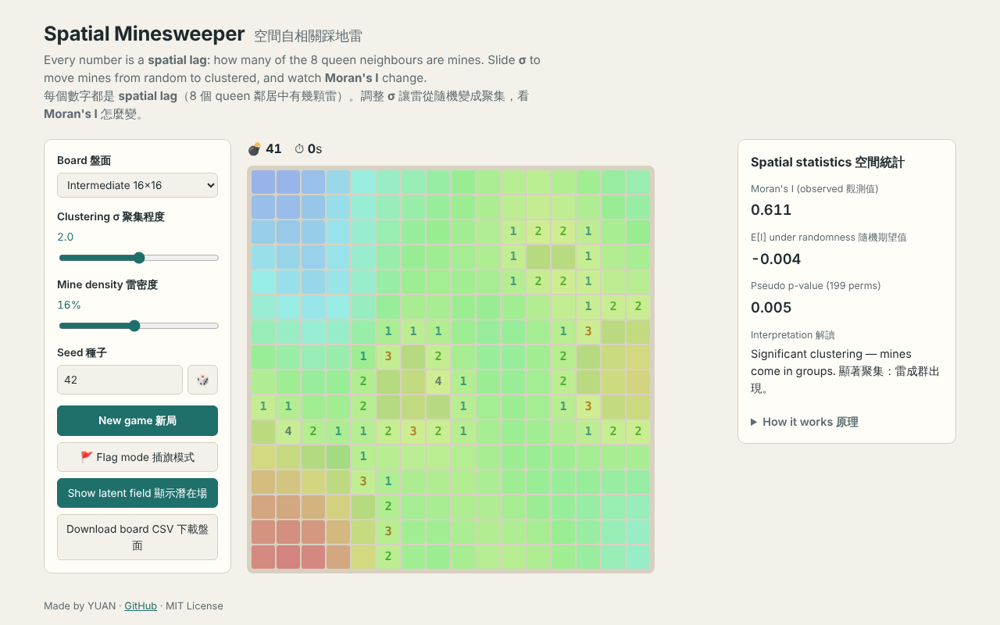

# Spatial Minesweeper · 空間自相關踩地雷

Minesweeper where mine placement follows a tunable **spatial autocorrelation**.
Slide σ from random to clustered and watch **Moran's I** respond.

用踩地雷體驗**空間自相關**：調整 σ，讓雷從隨機分布變成聚集，同時看 **Moran's I** 怎麼變。

**▶ Play 線上玩：** https://angus1060219.github.io/spatial-minesweeper/



---

## The idea 核心概念

Minesweeper is already a spatial-statistics game:

| Minesweeper 踩地雷 | Spatial statistics 空間統計 |
|---|---|
| The 8 cells around a square 周圍 8 格 | Queen contiguity weights **W** |
| The hint number 提示數字 | Spatial lag **W·x** of the mine indicator |
| Mines in groups vs scattered 雷成群 vs 分散 | Positive vs ~zero Moran's I |

When mines cluster (high Moran's I), one revealed mine tells you a lot about its neighbours. That is Tobler's First Law of Geography, turned into gameplay.

雷有聚集性時，看到一顆雷就能推測附近也很危險，這就是 Tobler 地理學第一定律的遊戲化。

## How mines are generated 雷怎麼產生

1. Draw Gaussian white noise on the grid. 在網格上產生高斯白雜訊。
2. Smooth it with a Gaussian filter of width **σ** (σ = 0 → no smoothing). 用寬度 σ 的高斯濾波平滑。
3. The top-k cells of this latent field become mines; the first click and its neighbours are always safe. 取潛在場最高的前 k 格當雷；第一下點擊處與鄰居保證安全。
4. Global Moran's I is computed with binary queen weights, plus a 199-permutation pseudo p-value. 用二元 queen 權重計算 Moran's I，並以 199 次置換檢定算 pseudo p-value。

Typical results on a 16×16 board at 16% density (mean of 20 seeds):

| σ | Mean Moran's I |
|---|---|
| 0 (random) | ≈ 0.01 |
| 2 (clustered) | ≈ 0.64 |

## Features 功能

- Three board sizes, σ and density sliders, reproducible seeds 三種盤面、σ 與密度滑桿、可重現的種子
- Live Moran's I, E[I] and permutation p-value 即時顯示 Moran's I、期望值、p-value
- "Show latent field" overlay to see the surface the mines came from 顯示產生雷的潛在場
- Export the board as CSV for analysis in Python 匯出盤面 CSV
- Right-click or flag mode to flag; click a number to chord 右鍵或插旗模式插旗；點數字快速展開
- No build step, no dependencies; works by opening `index.html` 無需建置，直接打開即可玩

## Verify with PySAL 用 PySAL 驗證

Download a board from the game, then:

```bash
pip install esda libpysal pandas numpy
python scripts/verify_moran.py board_16x16_sigma2_seed42.csv
```

```
NumPy Moran's I        : 0.6105
PySAL Moran's I        : 0.6105
Hint numbers == W·x    : True
```

Note: `esda.Moran` row-standardises W by default. The game uses binary weights, so the script passes `transformation="B"`.
注意：`esda.Moran` 預設會列標準化 W，遊戲用二元權重，所以腳本指定 `transformation="B"`。

## Tests 測試

```bash
node --test test/minefield.test.js
```

## Project structure 專案結構

```
index.html            game page 遊戲頁面
style.css
js/minefield.js       core logic (noise, blur, mines, spatial lag, Moran's I) 核心邏輯
js/app.js             UI 介面
scripts/verify_moran.py  PySAL cross-check 驗證腳本
test/                 Node unit tests 單元測試
```

## Roadmap 未來方向

- [ ] H3 hexagonal grid on a real map with hazard data as mines 真實地圖六角網格＋災害資料當雷
- [ ] Local Moran's I (LISA) overlay after the game 遊戲結束後顯示 LISA
- [ ] Probability solver heatmap 機率解題器熱度圖

## License

MIT © 2026 YUAN
